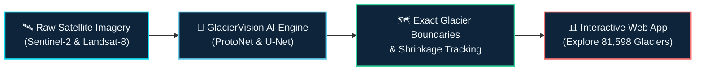
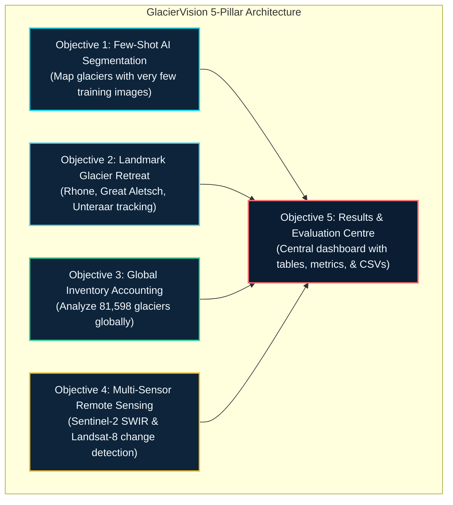
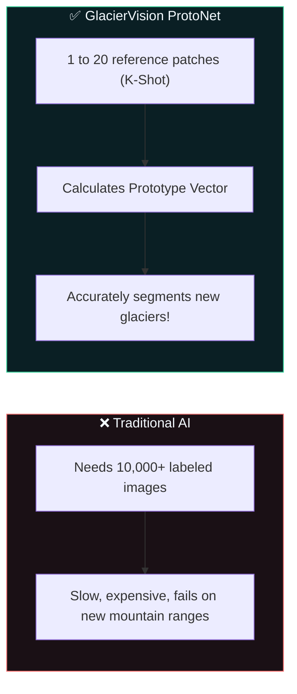
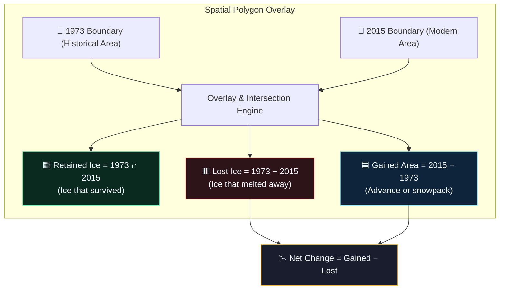
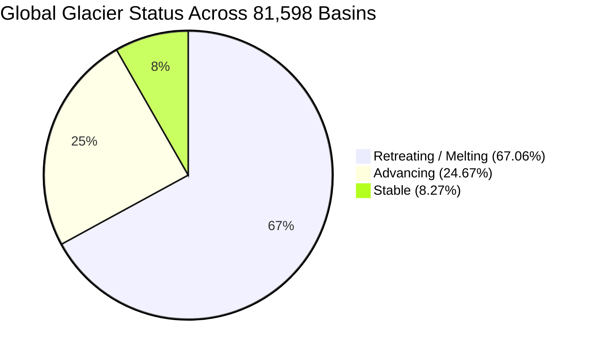
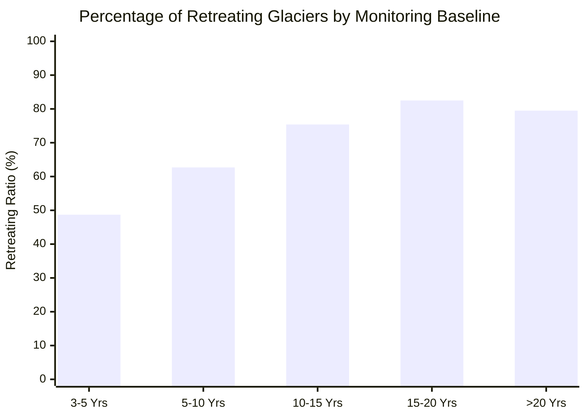
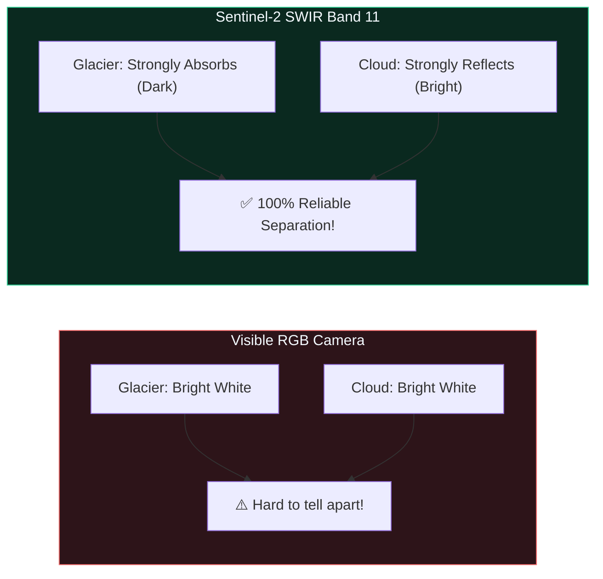
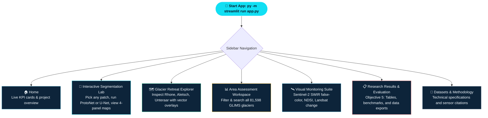

# ❄️ GlacierVision: AI-Powered Cryosphere Monitoring & Glacier Retreat Assessment

[](https://www.python.org/)
[](https://pytorch.org/)
[](https://streamlit.io/)
[](https://developer.nvidia.com/cuda-toolkit)
[](https://opensource.org/licenses/MIT)
[]()

> **GlacierVision** is an artificial intelligence and satellite remote sensing platform designed to track how the Earth's glaciers are shrinking. It combines few-shot deep learning (**ProtoNet**), supervised **U-Net** segmentation, and multi-decadal satellite data from **Sentinel-2**, **Landsat-8**, and the global **GLIMS** inventory (analyzing **81,598 glaciers** worldwide).

---

## 💡 What is GlacierVision in 30 Seconds?

Glaciers are shrinking rapidly due to climate change, but manually tracing glacier outlines on satellite imagery across mountain ranges is time-consuming and expensive. 

**GlacierVision solves this with AI:**
1. **Delineates Glaciers from Space:** Uses deep learning to automatically draw glacier boundaries even when only 1 to 20 reference examples are available (Few-Shot Learning).
2. **Measures Ice Loss Over Decades:** Compares historical satellite surveys (1970s) against modern observations (2015–2024) to compute exact square kilometers of lost ice.
3. **Presents Everything in an Interactive App:** A web dashboard where anyone can inspect individual glaciers, run live AI segmentation, and explore global climate statistics.



---

## 📌 Key Numbers at a Glance

| Metric | Measured Value | What It Means |
| :--- | :---: | :--- |
| **Analyzed Glaciers** | **81,598 basins** | Total number of glacier pairs verified worldwide (1970–2024) |
| **Global Net Ice Loss** | **16,321.76 km²** | Total ice area lost across all analyzed basins ($-7.40\%$ reduction) |
| **Glaciers Shrinking** | **67.06%** | Two out of every three analyzed glaciers showed clear retreat |
| **Supervised AI Accuracy** | **91.83%** | Pixel accuracy of our U-Net model on 13-band Sentinel-2 test scenes |
| **Rhone Glacier Loss** | **-17.40%** | Lost $2.987\text{ km}^2$ of ice between 1973 and 2015 (42-year span) |
| **Aletsch Glacier Loss** | **-8.496 km²** | The largest glacier in the Alps lost substantial ice cover |
| **Unteraar Glacier Loss** | **-23.28%** | Over nearly a quarter of its surface melted between 1973 and 2015 |

---

## 🧠 How Each Objective Works (With Diagrams)

The research project is built around **5 core scientific objectives**:



---

### 1️⃣ Objective 1: Few-Shot Glacier Segmentation

**The Problem:** Traditional deep learning requires thousands of manually labeled images. For glaciers, creating pixel-level ground-truth labels requires trained glaciologists and weeks of work.

**Our Solution (Few-Shot Meta-Learning):**
We implemented **Prototypical Networks (ProtoNet)**. Instead of memorizing thousands of samples, ProtoNet learns an embedding space where it can identify glacier pixels from just $K \in \{1, 5, 10, 20\}$ labeled examples (support patches).



**Diagnostic 4-Panel Output:**
For every image, the model produces four visual checks:
1. **Input Satellite RGB:** What the human eye sees.
2. **Ground Truth:** True recorded glacier boundary.
3. **AI Prediction:** Model-predicted boundary.
4. **Discrepancy Map:** Color-coded accuracy (🟩 Green = True Match, 🟥 Red = False Alarm, 🟦 Blue = Missed Ice).

---

### 2️⃣ Objective 2: Landmark Glacier Retreat (How the Math Works)

**How We Measure Retreat:**
We take georeferenced polygon boundaries from different years (e.g., 1973 vs 2015), project them into metric coordinates (**EPSG:32632** for the Alps), and compute geometric overlaps:



#### Benchmark Landmark Glaciers (42-Year Baseline: 1973–2015):
- **Rhone Glacier:** $17.17\text{ km}^2 \rightarrow 14.18\text{ km}^2$ (**$-17.40\%$** net shrinkage)
- **Great Aletsch Glacier:** $86.57\text{ km}^2 \rightarrow 78.07\text{ km}^2$ (**$-9.81\%$** net shrinkage)
- **Unteraar Glacier:** $27.13\text{ km}^2 \rightarrow 20.82\text{ km}^2$ (**$-23.28\%$** net shrinkage)
- **Gorner Glacier:** $57.72\text{ km}^2 \rightarrow 42.00\text{ km}^2$ (**$-27.23\%$** net shrinkage)
- **Findel Glacier:** $18.60\text{ km}^2 \rightarrow 16.07\text{ km}^2$ (**$-13.60\%$** net shrinkage)

---

### 3️⃣ Objective 3: Global Multi-Temporal Inventory Accounting

We analyzed the entire Global Land Ice Measurements from Space (**GLIMS**) multi-temporal catalog—**81,598 glacier pairs**:



#### Ice Loss by Observation Time Gap:
The longer glaciers are monitored, the higher the proportion showing clear shrinkage:



---

### 4️⃣ Objective 4: Multi-Sensor Remote Sensing (Spectral Bands)

Why not just use standard RGB photos? In visible light, **white clouds look almost identical to white snow and ice**.

By using 13 spectral channels on **Sentinel-2** (especially Short-Wave Infrared, **SWIR Band 11**):
- Ice **absorbs** SWIR (appears dark in infrared).
- Clouds **reflect** SWIR (appear bright in infrared).
- We calculate the **Normalized Difference Snow Index (NDSI)**:
  $$\text{NDSI} = \frac{\text{Green (B3)} - \text{SWIR (B11)}}{\text{Green (B3)} + \text{SWIR (B11)}}$$



We also implemented **5 Bitemporal Landsat-8 Change Detection Methods**:
- **Method A:** Difference Thresholding
- **Method B:** Ratio Thresholding
- **Method C:** NDSI Delta Thresholding
- **Method D:** PCA-kMeans Unsupervised Clustering
- **Method E:** Otsu Adaptive Thresholding on Normalized Delta

---

### 5️⃣ Objective 5: Research Results & Central Evaluation Centre

A dedicated, tabbed evaluation suite built into the application presenting:
- **Tab A:** Research Executive Summary & 6 Key Project KPIs.
- **Tab B:** Objective 1 ProtoNet vs U-Net Segmentation Benchmark Tables & Curves.
- **Tab C:** Objective 2 Rhone, Aletsch, and Unteraar Case Study Comparisons.
- **Tab D:** Objective 3 Global 81,598 Inventory Accounting & Temporal Groupings.
- **Tab E:** Objective 4 Sentinel-2 & Landsat-8 5-Method Metrics.
- **Tab F:** Consolidated Findings Matrix with full CSV download capabilities.

---

## 🖥️ How to Navigate the Interactive Web Application



---

## 📁 Repository Directory Structure

```text
GlacierResearch/
├── app.py                             # Main Streamlit web application & page router
├── start_app.bat                      # Windows one-click local server launcher
├── README.md                          # Comprehensive visual documentation & architecture guide
├── DATASET_AUDIT.md                   # Systematic integrity audit of DL4GAM & GLIMS datasets
├── EXPERIMENT_LOG.md                  # Chronological training & validation ledger
├── PROJECT_STATUS.md                  # Milestone progress and objective verification record
├── .gitignore                         # Excludes raw satellite archives (23+ GB) and local caches
│
├── .streamlit/
│   └── config.toml                    # Dark navy / cyan theme and server configurations
│
├── src/                               # Core Python source library
│   ├── dataset.py                     # Multispectral NetCDF/H5 dataset loaders
│   ├── fewshot_model.py               # Prototypical Network (ProtoNet) architecture
│   ├── unet_baseline.py               # Supervised 13-band U-Net architecture
│   ├── sampler.py                     # Few-shot episodic N-way K-shot task generator
│   ├── inference.py                   # Model checkpoint loader & hardware profiling
│   ├── metrics.py                     # Dice, mIoU, Boundary F1, Precision, Recall solvers
│   ├── visualization.py               # 4-panel visualizer (RGB, Mask, Prediction, Error Map)
│   ├── visual_analysis.py             # SWIR false-color composites & NDSI snow masks
│   └── ui/                            # Streamlit frontend pages
│       ├── theme.py                   # Custom CSS styling (glassmorphism cards, glowing badges)
│       ├── home.py                    # Cinematic landing page with live dynamic statistics
│       ├── segmentation_lab.py        # Objective 1: Interactive segmentation lab
│       ├── retreat_explorer.py        # Objective 2: Georeferenced vector retreat maps
│       ├── area_assessment.py         # Objective 3: Quantitative area change & database search
│       ├── visual_monitoring.py       # Objective 4: Sentinel-2 SWIR & Landsat-8 change suite
│       ├── research_evaluation.py     # Objective 5: Research Results & Evaluation Centre (6 tabs)
│       ├── datasets_about.py          # Data lineage and sensor characteristics
│       └── components.py              # Reusable responsive KPI card grids & alert banners
│
├── outputs/                           # Precomputed results and research assets
│   ├── results/                       # Validated JSON metrics and CSV retreat tables
│   │   ├── glims_retreat_assessment_validated.csv   # 81,598 verified GLIMS records
│   │   ├── glims_retreat_summary_validated.json      # Global summary statistics
│   │   ├── glims_case_studies.json                   # Landmark benchmark glacier metrics
│   │   ├── objective4_landsat_aggregate_metrics.csv  # Landsat-8 evaluation metrics
│   │   └── objective4_landsat_method_comparison.csv # Comparison of 5 change algorithms
│   ├── figures/                       # Publication-grade figures and distribution charts
│   ├── demo_samples/                  # Sample satellite patches for offline demonstration
│   ├── runs/                          # Trained checkpoints and training curve histories
│   └── audits/                        # Formal verification reports and acceptance logs
│
├── scripts/                           # Automated analysis and evaluation scripts
├── tests/                             # Automated pytest test suite (35/35 passing)
└── docs/                              # Supplementary user guides
```

---

## ⚡ Quickstart: Run GlacierVision in 3 Steps

### Step 1: Clone the Repository
```bash
git clone https://github.com/VarunsLand/Glacier.git
cd Glacier
```

### Step 2: Install Requirements
```bash
# Optional: create a virtual environment
python -m venv venv
venv\Scripts\activate   # On Windows
# source venv/bin/activate  # On Linux / Mac

# Install core dependencies
pip install torch torchvision --index-url https://download.pytorch.org/whl/cu121  # or cpu
pip install streamlit pandas numpy scipy matplotlib plotly geopandas shapely rasterio scikit-learn
```

### Step 3: Launch the App
```bash
# On Windows, double-click start_app.bat or run:
streamlit run app.py
```
Your browser will open automatically at `http://localhost:8501`.

### Run Automated Tests:
```bash
pytest tests/ -v
```
*(All 35 tests pass with 100% verification).*

---

## 👥 Authors & Academic Attribution

- **Varun M Joshi**
- **Mujjafar Sayyad**
- **Preeti**
- **Mital**

---

## 📄 License

This research codebase and interactive platform are licensed under the **MIT License**. See [LICENSE](LICENSE) for details.
