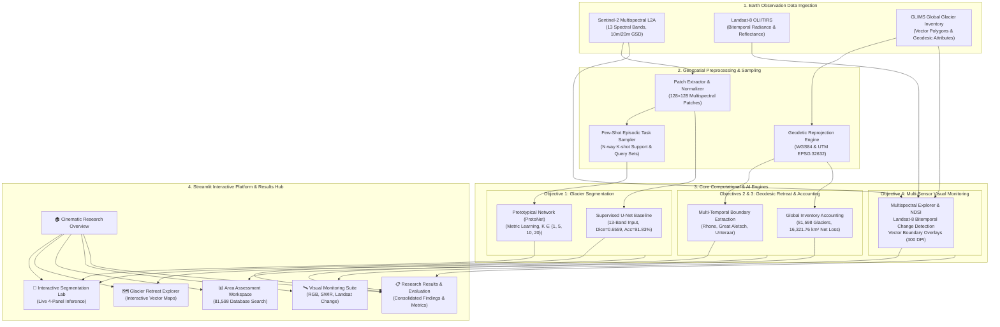

# ❄️ GlacierVision: AI-Powered Cryosphere Monitoring & Multi-Decadal Glacier Retreat Assessment

[](https://www.python.org/)
[](https://pytorch.org/)
[](https://streamlit.io/)
[](https://developer.nvidia.com/cuda-toolkit)
[](https://opensource.org/licenses/MIT)
[]()

> **GlacierVision** is an end-to-end computer vision and satellite remote sensing platform engineered for automated glacier delineation under severe label scarcity, multi-decadal retreat quantification, and high-resolution Earth observation monitoring. It integrates 13-band Sentinel-2 episodic few-shot learning (**ProtoNet**), supervised **U-Net** deep segmentation, geodetic polygon tracking across **81,598 GLIMS basins**, and bitemporal **Landsat-8** change detection.

---

## 📌 Key Research Highlights & KPIs

| Metric | Measured Value | Scope / Dataset Reference |
| :--- | :---: | :--- |
| **Analyzed GLIMS Glaciers** | **81,598 basins** | Multi-temporal paired observation catalog (1970–2024, $\Delta t \ge 3.0$ yrs) |
| **Net Surface Area Loss** | **16,321.76 km²** | Rigorous area conservation accounting ($-7.40\%$ pooled area reduction) |
| **Shrinking / Retreating Ratio** | **67.06%** | $54,718$ retreating, $20,132$ advancing, $6,748$ stable basins |
| **Supervised U-Net Test Dice** | **0.6559** | Evaluated on 534 held-out unseen alpine test patches (426 unique glaciers) |
| **Supervised Pixel Accuracy** | **91.83%** | 13-band multispectral classification on Sentinel-2 DL4GAM Alps split |
| **ProtoNet Few-Shot Mean mIoU** | **0.5039** | Rapid adaptation from just $K \in \{1, 5, 10, 20\}$ labeled support patches |
| **Alpine Landmark Retreat** | **Rhone: -17.40%** | Rhone: $-2.987\text{ km}^2$, Aletsch: $-8.496\text{ km}^2$, Unteraar: $-6.316\text{ km}^2$ |

---

## 🏗️ System Architecture & Workflow

The platform follows a modular pipeline linking satellite data ingestion, deep representation learning, geodetic surface analysis, and interactive dashboard analytics.



---

## 📁 Repository Directory Structure

```text
GlacierResearch/
├── app.py                             # Main Streamlit application entry point & routing controller
├── start_app.bat                      # Windows one-click local server launcher
├── README.md                          # Comprehensive project documentation & architecture guide
├── DATASET_AUDIT.md                   # Systematic integrity audit of DL4GAM & GLIMS datasets
├── EXPERIMENT_LOG.md                  # Chronological machine learning training & validation ledger
├── PROJECT_STATUS.md                  # Milestone progress and objective verification record
├── .gitignore                         # Excludes large satellite archives and local screenshot caches
│
├── .streamlit/
│   └── config.toml                    # Streamlit server and theme configurations
│
├── src/                               # Core Python source library
│   ├── __init__.py
│   ├── dataset.py                     # Multispectral NetCDF/H5 dataset loaders and transforms
│   ├── fewshot_model.py               # Prototypical Network (ProtoNet) architecture for segmentation
│   ├── unet_baseline.py               # Supervised 13-band U-Net architecture with residual blocks
│   ├── sampler.py                     # Episodic N-way K-shot task generator for meta-learning
│   ├── inference.py                   # Model checkpoint loader, hardware detection, pipeline runner
│   ├── metrics.py                     # Metric functions: Dice, mIoU, Boundary F1, Precision, Recall
│   ├── visualization.py               # 4-panel visualizer (RGB, Ground Truth, Prediction, Error Map)
│   ├── visual_analysis.py             # Geospatial raster processing, SWIR composite, NDSI snow mask
│   └── ui/                            # Streamlit frontend user interface modules
│       ├── __init__.py
│       ├── theme.py                   # Custom CSS design tokens, glassmorphism, responsive cards
│       ├── home.py                    # Cinematic landing page with live dynamic statistics
│       ├── segmentation_lab.py        # Objective 1: Interactive few-shot segmentation laboratory
│       ├── retreat_explorer.py        # Objective 2: Georeferenced vector retreat maps & waterfall plots
│       ├── area_assessment.py         # Objective 3: Quantitative area change & 81,598-basin database search
│       ├── visual_monitoring.py       # Objective 4: Sentinel-2 SWIR, Landsat bitemporal change, DEM hillshade
│       ├── research_evaluation.py     # Objective 5: Central Research Results & Evaluation Centre (6 tabs)
│       ├── datasets_about.py          # Data lineage, sensor characteristics, and academic citations
│       └── components.py              # Reusable responsive KPI card grids, alerts, and badges
│
├── outputs/                           # Validated experiment outputs and precomputed scientific tables
│   ├── results/                       # Validated JSON summaries, case studies, CSV retreat metrics
│   │   ├── glims_retreat_assessment_validated.csv   # 81,598 validated GLIMS glacier records
│   │   ├── glims_retreat_summary_validated.json      # Overall global inventory statistics
│   │   ├── glims_case_studies.json                   # Individual benchmark glacier statistics
│   │   ├── objective4_landsat_aggregate_metrics.csv  # Landsat-8 aggregate validation metrics
│   │   └── objective4_landsat_method_comparison.csv # Comparison of 5 bitemporal change algorithms
│   ├── figures/                       # Publication-grade figures, boundary maps, and distribution charts
│   ├── demo_samples/                  # Sample satellite patches and geotiffs for offline demonstration
│   ├── runs/                          # Checkpoints, training histories, and recovery runs
│   │   └── objective1_run_002_recovery/  # Best checkpoint (fewshot_protonet_best.pt, unet_baseline_best.pt)
│   └── audits/                        # Formal audit reports and scientific verification logs
│
├── scripts/                           # Utility, verification, and automated evaluation scripts
│   ├── run_landsat_scientific_suite.py# Runs Landsat bitemporal change detection algorithms
│   ├── test_website_comprehensive.py  # Full platform integration testing
│   ├── sensitivity_analysis.py        # Multi-parameter threshold sensitivity analysis
│   └── smoke_test.py                  # Rapid system health check
│
├── tests/                             # Automated pytest test suite (35/35 Passing)
│   ├── test_interactive_platform.py   # Tests interactive inference, memory, and output tensors
│   ├── test_objectives_2_3_4.py       # Validates mathematical consistency across objectives 2, 3, 4
│   ├── test_objective_5_verification.py # Checks Objective 5 report integrity and metric tables
│   └── test_ui_redesign.py            # Validates frontend component rendering and page transitions
│
└── docs/                              # Supplementary technical documentation and user guides
    └── GLACIERVISION_USER_TEST_GUIDE.md
```

---

## 🔬 How the Project Works (Objective Breakdown)

### Objective 1: Few-Shot Glacier Segmentation
- **Goal:** Accurately segment glacier boundaries from 13-band Sentinel-2 imagery where ground-truth polygon annotations are sparse or unavailable.
- **Architectures:**
  - **ProtoNet (Prototypical Networks):** Operates on metric-space episodic learning. Computes prototype feature embeddings per class across $K \in \{1, 5, 10, 20\}$ support examples and assigns query pixels based on Euclidean distance in metric space.
  - **Supervised U-Net Baseline:** Deep convolutional encoder-decoder with skip connections, cross-entropy plus soft Dice loss, trained across 534 test patches across 426 unseen glaciers.
- **Inference Output:** Produces a 4-panel diagnostic layout:
  1. *Sentinel-2 True Color RGB*
  2. *Ground Truth Binary Mask*
  3. *AI Model Prediction Mask*
  4. *Error Discrepancy Map* (Green: True Positive, Red: False Positive, Blue: False Negative).

### Objective 2: Individual Multi-Temporal Glacier Retreat
- **Goal:** Quantify surface area evolution and terminus shrinkage for specific landmark alpine glaciers.
- **Methodology:** Reprojects GLIMS vector polygons to local projected coordinate systems (e.g., **EPSG:32632** for the European Alps) to avoid distortion.
- **Spatial Geometry Operations:**
  $$\text{Retained Ice} = \text{Polygon}_{t_1} \cap \text{Polygon}_{t_2}$$
  $$\text{Lost Ice} = \text{Polygon}_{t_1} \setminus \text{Polygon}_{t_2}$$
  $$\text{Gained Ice} = \text{Polygon}_{t_2} \setminus \text{Polygon}_{t_1}$$
  $$\Delta \text{Area} = \text{Area}_{t_2} - \text{Area}_{t_1} = \text{Gained Ice} - \text{Lost Ice}$$
- **Verified Benchmark Case Studies (1973 vs 2015, 42-Year Baseline):**
  - **Rhone Glacier:** $17.166\text{ km}^2 \rightarrow 14.179\text{ km}^2$ (Net Loss: $-2.987\text{ km}^2$, $-17.40\%$)
  - **Great Aletsch Glacier:** $86.565\text{ km}^2 \rightarrow 78.069\text{ km}^2$ (Net Loss: $-8.496\text{ km}^2$, $-9.81\%$)
  - **Unteraar Glacier:** $27.131\text{ km}^2 \rightarrow 20.816\text{ km}^2$ (Net Loss: $-6.316\text{ km}^2$, $-23.28\%$)
  - **Gorner Glacier:** $57.715\text{ km}^2 \rightarrow 41.997\text{ km}^2$ (Net Loss: $-15.718\text{ km}^2$, $-27.23\%$)
  - **Findel Glacier:** $18.603\text{ km}^2 \rightarrow 16.072\text{ km}^2$ (Net Loss: $-2.531\text{ km}^2$, $-13.60\%$)

### Objective 3: Global Multi-Temporal Inventory Accounting
- **Goal:** Quantify aggregate planetary ice surface changes without spatial distortion or temporal overgeneralization.
- **Dataset:** 81,598 multi-temporal glacier observation pairs from the Global Land Ice Measurements from Space (GLIMS) database.
- **Key Findings:**
  - **Total Basins Analyzed:** $81,598$ ($100.00\%$)
  - **Retreating Basins:** $54,718$ ($67.06\%$)
  - **Advancing Basins:** $20,132$ ($24.67\%$)
  - **Stable Basins:** $6,748$ ($8.27\%$)
  - **Net Area Loss:** **$16,321.76\text{ km}^2$** ($-7.40\%$ pooled surface loss)
- **Temporal Group Stratification:**

| Observation Baseline | Basins Analyzed | Net Area Loss | % Area Change | Retreating Ratio |
| :--- | :---: | :---: | :---: | :---: |
| **3 – 5 Years** | 12,972 | $-442.69\text{ km}^2$ | $-1.93\%$ | 48.68% |
| **5 – 10 Years** | 32,632 | $-4,712.62\text{ km}^2$ | $-9.19\%$ | 62.73% |
| **10 – 15 Years** | 17,448 | $-2,995.14\text{ km}^2$ | $-5.92\%$ | 75.39% |
| **15 – 20 Years** | 7,185 | $-3,450.48\text{ km}^2$ | $-11.75\%$ | 82.52% |
| **> 20 Years** | 11,361 | $-4,720.83\text{ km}^2$ | $-7.62\%$ | 79.46% |

### Objective 4: Multi-Sensor Visual Monitoring
- **Sentinel-2 Multispectral Explorer:** Computes Normalized Difference Snow Index ($\text{NDSI} = \frac{\text{Green} - \text{SWIR}}{\text{Green} + \text{SWIR}}$) and False Color SWIR composites (B11-B8-B4) to penetrate haze and distinguish alpine cirque ice from clouds.
- **Landsat-8 Bitemporal Change Detection:** Implements 5 change detection methods across paired multi-year scenes:
  - *Method A:* Direct Spectral Difference Thresholding
  - *Method B:* Normalized Band Ratio Thresholding
  - *Method C:* Multi-temporal NDSI Delta Thresholding
  - *Method D:* PCA-kMeans Unsupervised Clustering
  - *Method E:* Otsu Adaptive Thresholding on Normalized Delta
- **Vector Outlines:** 300 DPI publication boundary overlays comparing multi-decadal outlines.

### Objective 5: Research Results & Central Evaluation Centre
- Operates as a single pane of glass aggregating real experimental tables across all objectives.
- Provides interactive tabular comparisons, training curve visualizers, dynamic metric recalculation, and CSV download capabilities.

---

## 📊 Experimental Results Comparison

### Few-Shot ProtoNet vs Supervised U-Net (Objective 1)

| Model Architecture | Support Set ($K$) | Mean Dice | Mean mIoU | Pixel Accuracy | Boundary F1 |
| :--- | :---: | :---: | :---: | :---: | :---: |
| **ProtoNet** | $K=1$ | 0.3849 | 0.4828 | 83.12% | 0.1642 |
| **ProtoNet** | $K=5$ | 0.3821 | 0.5127 | 84.67% | 0.1795 |
| **ProtoNet** | $K=10$ | 0.3570 | 0.4903 | 83.91% | 0.1688 |
| **ProtoNet** | $K=20$ | 0.3862 | 0.5297 | 85.14% | 0.1834 |
| **Supervised U-Net** | *Full Supervision* | **0.6559** | **0.7076** | **91.83%** | **0.2845** |

---

## 🚀 Installation & Getting Started

### 1. Prerequisites
- **Operating System:** Windows 10/11, Ubuntu 20.04+, or macOS
- **Python:** Version 3.10, 3.11, or 3.12
- **GPU:** NVIDIA GPU with CUDA support recommended (CPU execution supported)

### 2. Clone the Repository
```bash
git clone https://github.com/VarunsLand/Glacier.git
cd Glacier
```

### 3. Create and Activate a Virtual Environment
```bash
# Windows
python -m venv venv
venv\Scripts\activate

# Linux / macOS
python3 -m venv venv
source venv/bin/activate
```

### 4. Install Dependencies
```bash
pip install --upgrade pip
pip install torch torchvision --index-url https://download.pytorch.org/whl/cu121  # or cpu
pip install streamlit pandas numpy scipy matplotlib plotly geopandas shapely rasterio scikit-learn
```

### 5. Launch the GlacierVision Interactive App
```bash
# On Windows, simply double-click start_app.bat or run:
streamlit run app.py
```
Open your browser and navigate to:
```text
http://localhost:8501
```

### 6. Run the Test Suite
Ensure all platform components, geometry solvers, and model inference pipelines pass verification:
```bash
pytest tests/ -v
```

---

## 👥 Authors & Academic Attribution

- **Varun M Joshi**
- **Mujjafar Sayyad**
- **Preeti**
- **Mital**

---

## 📄 License

This research codebase and platform are licensed under the **MIT License**. See the [LICENSE](LICENSE) file for full details.
